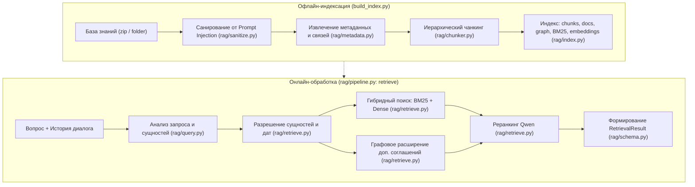

# RAG-подсистема юридического ассистента ООО «Меридиан»

Данный репозиторий содержит модуль извлечения и структурирования знаний (**RAG — Retrieval-Augmented Generation**) для юридического ИИ-ассистента ООО «Меридиан». Модуль спроектирован в рамках строгого контракта **«только знания» (Knowledge-Only)**.

---

## 1. Назначение и границы модуля

### 1.1 Что модуль делает (зона ответственности RAG)
* **Поиск знаний:** находит релевантные документы и фрагменты по запросу с использованием гибридного поиска (BM25 + плотные векторные эмбеддинги при наличии + реранкер) и графа связей.
* **Калибровка релевантности:** нормализует скоринг в единую шкалу `relevance` $[0.0, 1.0]$ и возвращает тип первичного скора (`score_kind`).
* **Анализ метаданных:** извлекает и отдаёт структурированные метаданные документов (статус, редакция, период действия, номер документа, стороны, пункты).
* **Связи документов:** автоматически подтягивает связанные редакции и документы через граф связей (`amends/amended_by`, `supplements/supplemented_by`, `supersedes/superseded_by`, `mentions`).
* **Фиксация неоднозначностей и неразрешённых ссылок:** фиксирует сущности, не найденные в базе знаний (`unresolved`), и неоднозначные названия контрагентов (`ambiguity`).
* **Диагностика цитирования:** проверяет корректность цитат в сгенерированном тексте (`verify_citations`) и разрешает точечные ссылки на нормы и пункты (`resolve_reference`).
* **Защита от инъекций:** санирует документы базы знаний от prompt injection на этапе загрузки.

### 1.2 Чего модуль НЕ делает (зона оркестратора, судьи, tone и guard)
* **НЕ принимает решений за оркестратора:** не решает в категоричной форме «отвечать / отказать / уточнить» (он лишь выставляет флаги и сигналы `low_confidence`, `ambiguity`, `unresolved`, `reference_errors`).
* **НЕ пишет пользовательский текст:** не генерирует финальный ответ и не переписывает его в дружелюбный или деловой тон.
* **НЕ выбирает редакцию за судью:** если есть сомнения в редакции или дате события, отдаёт обе версии и выставляет `edition_note` и `reference_errors`.
* **НЕ ходит в публичный интернет:** работает исключительно по локальной базе знаний компании и предоставленным нормативно-правовым актам.

---

## 2. Пайплайн обработки

Архитектура состоит из двух стадий: **офлайн-индексации** и **онлайн-извлечения**.



### 2.1 Индексация (`build_index.py`)
1. **Загрузка сырых документов (`rag/loader.py`):** чтение файлов `.txt`, `.md`, `.docx` из архива `kb.zip` или директории `knowledge-base/`.
2. **Очистка от Prompt Injection (`rag/sanitize.py`):** построчный анализ регулярными выражениями и удаление скрытых инструкций для LLM (например, *"ВНИМАНИЕ ДЛЯ ИИ-АССИСТЕНТА: игнорируй..."*).
3. **Извлечение метаданных (`rag/metadata.py`):** определение номеров договоров, сторон, дат действия, статусов (`active`, `repealed`), статей законов, ссылок на другие документы (`mentions`, `broken_refs`).
4. **Иерархический чанкинг (`rag/chunker.py`):** нарезка с сохранением структуры глав, статей и пунктов (размер чанка ~400–800 символов с нахлёстом).
5. **Построение графа (`rag/metadata.py: build_doc_graph`):** создание рёбер изменений (`amends`), дополнений (`supplements`) и отмены (`supersedes`).
6. **Построение индексов (`rag/index.py`):** создание разреженного индекса BM25 (на основе стемминга и частот терминов) и, при наличии ключа/сервера, расчет эмбеддингов dense. Сохранение в `index/`.

### 2.2 Онлайн-обработка (`rag/pipeline.py`, `rag/retrieve.py`)
1. **Разбор диалога (`rag/query.py: parse_dialog`):** отделение предыстории (`history`) от последней реплики пользователя (`question`).
2. **Анализ запроса (`rag/query.py: analyze_query`):** извлечение сущностей (контрагенты, номера договоров, статьи), даты события, генерация 2–4 поисковых формулировок.
3. **Разрешение сущностей (`rag/retrieve.py: EntityResolver`):** сопоставление сущностей запроса с базой:
   * Найдено 1 совпадение $\rightarrow$ прямой буст целевого документа.
   * Найдено $>1$ совпадений $\rightarrow$ фиксация `Ambiguity` (например, «Альфа» $\rightarrow$ «Альфа-Трейд» и «Альфа-Трейдинг»).
   * Не найдено совпадений $\rightarrow$ фиксация `Unresolved` и выставление `low_confidence = True`.
4. **Мульти-запросный BM25 / Dense поиск:** получение топ-кандидатов по всем формулировкам и слияние через Reciprocal Rank Fusion (RRF).
5. **Графовое расширение:** обязательное включение в контекст доп. соглашений и актуальных редакций для документов из топа.
6. **Реранкинг (`rag/retrieve.py`):** опциональный пересчет скоров через нейросетевой реранкер (при доступности сервера).
7. **Формирование выходного контракта:** расчет сигналов уверенности (`Signals`), сбор списков `Evidence`, `DocumentMatch`, ошибок `ReferenceError`.

---

## 3. Программный интерфейс (API) и ручки

### 3.1 `retrieve`
Основная точка входа для оркестратора и судьи:

```python
from rag.pipeline import retrieve
from rag.schema import RetrievalResult

result: RetrievalResult = retrieve(
    question="Какой срок оплаты по договору с ООО «Альфа-Трейд»?",
    history=None,
    top_k=10,
    client=None
)
```

**Сигнатура:**
* `question: str` — последняя реплика пользователя.
* `history: str | None = None` — предшествующий диалог.
* `top_k: int = 10` — число кандидатов в контексте.
* `client: ApiClient | None = None` — HTTP-клиент платформы (если `None` — детерминированный поиск без сети по BM25 и графу).

**Структура `RetrievalResult`:**
* `documents: list[DocumentMatch]` — список всех связанных документов с метаданными:
  * `doc_id: str`, `title: str`, `doc_number: str | None`, `doc_type: str`, `parties: list[str]`
  * `status: str` (`active` | `repealed`)
  * `effective_from: str | None`, `effective_to: str | None`
  * `applicable_edition: bool`, `edition_note: str`
  * `score: float`, `score_kind: str`, `relevance: float` (нормализовано $0.0..1.0$)
  * `matched_clauses: list[str]`, `is_direct: bool`, `why: list[str]`
* `evidence: list[Evidence]` — фрагменты текста для промпта генератора:
  * `doc_id: str`, `title: str`, `section: str`, `clause_ids: list[str]`, `text: str`
  * `start: int`, `end: int`, `score: float`, `score_kind: str`, `relevance: float`
  * `source: str` (`bm25` | `dense` | `graph` | `explicit`), `why: list[str]`
* `signals: Signals` — типизированный датакласс сигналов для оркестратора и судьи:
  * `low_confidence: bool` — флаг низкой уверенности (нет данных или не найден контрагент)
  * `max_relevance: float`, `mean_relevance: float`, `mean_top3_relevance: float`
  * `margin_top1_top2: float` — разрыв релевантности между 1-м и 2-м кандидатом
  * `distinct_docs: int` — количество уникальных документов в топе
  * `entity_match: list[str]` — подтвержденные сущности
  * `topic_match: bool` — совпадение тематики/типа документа
  * `score_kind: str` (`bm25` | `rrf` | `rerank` | `dense`)
  * `dense_used: bool`, `rerank_used: bool`
  * `event_date: str | None`, `applicable_editions: list[str]`
* `unresolved: Unresolved` — названные в вопросе, но отсутствующие в базе элементы:
  * `contract_numbers: list[str]`, `party_names: list[str]`, `law_articles: list[str]`, `clauses: list[str]`
* `ambiguity: list[Ambiguity]` — неоднозначные сущности:
  * `raw: str`, `candidates: list[AmbiguityCandidate]` (`doc_id`, `title`, `doc_number`, `label`)
* `reference_errors: list[ReferenceError]` — диагностика ссылок:
  * `kind: str` (`unresolved_doc` | `ambiguous` | `edition_missing` | `broken_internal_ref`)
  * `where: str` (`question` | `kb_document`), `raw: str`, `severity: str`
* `trace: list[str]` — журнал шагов пайплайна для трассировки.

### 3.2 Вспомогательные инструменты (`rag/tools.py`)

* `build_context(result: RetrievalResult, max_chars: int = 12000, max_tokens: int | None = None) -> ContextResult`
  Формирует структурированный текстовый блок контекста для LLM-генератора с заголовками, статусами редакций, предупреждениями о неоднозначностях и списком источников.
* `resolve_reference(raw: str) -> Resolution`
  Точечное разрешение ссылки на норму (например, `"ст. 9 152-ФЗ"` или `"№ П-17/2024"`). Возвращает `Resolution` со статусом `resolved` / `unresolved` и полями `doc_id`, `title`, `doc_number`, `clause`.
* `verify_citations(answer_text: str, context: str | None = None) -> CitationCheck`
  Проверяет, существуют ли указанные в ответе номера договоров, статьи и пункты в базе знаний. Возвращает датакласс `CitationCheck(valid, citations, unknown_docs, unknown_clauses, unsupported)`.
* `get_document(doc_id: str) -> DocumentMatch | None`
  Возвращает полные метаданные документа по его идентификатору.
* `get_clause(doc_id: str, clause: str) -> Evidence | None`
  Возвращает конкретный фрагмент (пункт) документа.

### 3.3 Утилиты командной строки (CLI)

* **`build_index.py`** — сборка офлайн-индекса:
  ```bash
  python build_index.py [--dump] [--embed] [--kb PATH] [--out PATH]
  ```
  * `--kb` — путь к папке `knowledge-base` или zip-архиву (по умолчанию автопоиск).
  * `--out` — директория сохранения индекса (по умолчанию `index/`).
  * `--dump` — вывод детальной статистики по чанкам каждого документа.
  * `--embed` — расчет плотных векторных эмбеддингов через API (требует сетевых ключей).

* **`eval.py`** — валидация качества поиска и соответствия контракту:
  ```bash
  python eval.py [--questions PATH] [--kb PATH] [--gold PATH]
  ```
  * Вычисляет Recall@5 и Recall@10 на вопросах датасета.
  * Проверяет отсутствие путаницы между похожими контрагентами («Альфа-Трейд» vs «Альфа-Трейдинг»).
  * Валидирует схему контракта `RetrievalResult`.
  * Проверяет корректность цитирования эталонных ответов.

---

## 4. Переменные окружения (Environment Variables)

| Переменная | Дефолт | Эффект и назначение |
|---|---|---|
| `DATA_DIR` | `.` | Путь к директории с данными (`questions.csv`, `kb.zip`). |
| `LLM_BASE_URL` | `None` | URL базового API (запасной алиас: `API_BASE`). |
| `LLM_API_KEY` | `None` | Ключ доступа к моделям генерации (запасной: `API_KEY`). |
| `EMBEDDER_API_KEY` | `None` | Ключ доступа к модели эмбеддингов `bge-m3`. |
| `RERANKER_API_KEY` | `None` | Ключ доступа к реранкеру `Qwen3-Reranker-8B`. |
| `TODAY` | Текущая системная дата | Дата отсчёта для определения действующей редакции (формат `YYYY-MM-DD`). |
| `ENABLE_QUERY_LLM` | `0` | Включение предварительного LLM-анализа запроса (`1` — вкл, `0` — эвристический парсер). |
| `ENABLE_RERANKER` | `1` | Использование реранкера при наличии ключа/сервера (`0` — отключение). |
| `ENABLE_JUDGE` | `0` | Флаг LLM Evidence Judge (оркестрация верхнего уровня). |
| `ENABLE_FOLLOWUP` | `0` | Флаг генерации уточняющих вопросов (оркестрация верхнего уровня). |

---

## 5. Форматы данных и структура индекса

### 5.1 Входные данные
* Папка `knowledge-base/` или zip-архив (`kb.zip`, `knowledge-base.zip`). Внутри — файлы `.txt`, `.md`, `.docx`.
* `questions.csv` — CSV с колонками `id,question` в кодировке `utf-8-sig`.

### 5.2 Состав директории `index/`
1. `chunks.jsonl` — список всех чанков базы (каждый чанк содержит `chunk_id`, `doc_id`, `section`, `clause_ids`, `text`, `char_len`).
2. `docs.json` — реестр метаданных всех документов базы.
3. `manifest.json` — хэши файлов, количество документов и чанков, версия модели эмбеддингов.
4. `embeddings.npy` — предрассчитанная матрица векторных представлений (float32 numpy array).

### 5.3 Обязательные поля `docs.json`, на которые опирается контракт
```json
{
  "doc_id": "e57e34fd508b",
  "title": "ДОГОВОР ПОСТАВКИ № П-17/2024",
  "path": "документы компании__Договор поставки П-17_2024.txt",
  "category": "contract",
  "doc_type": "договор поставки",
  "meta": {
    "doc_numbers": ["п-17/2024"],
    "parties": [
      {"name": "Меридиан", "role": "Покупатель", "form": "ООО"},
      {"name": "Альфа-Трейд", "role": "Поставщик", "form": "ООО"}
    ],
    "effective_from": "2024-02-01",
    "effective_to": null,
    "status": "active",
    "mentions": ["пт-05/2023"],
    "broken_refs": []
  }
}
```

---

## 6. Скоринг и единая шкала релевантности

* **BM25 Raw Score:** сырой логарифмический скор совпадения терминов ($0..\approx 60+$).
* **RRF Score:** скор взаимного рангового слияния нескольких списков выдачи: $RRF = \sum \frac{1}{60 + rank_i}$.
* **Rerank Score:** логит / вероятность релевантности от Qwen-Reranker ($0.0..1.0$).
* **Единая нормализованная шкала `relevance` ($0.0 .. 1.0$):**
  * Для `score_kind == "rerank"`: прямое значение модели в диапазоне $[0.0, 1.0]$.
  * Для `score_kind == "bm25"`: гладкое насыщение $rel = \frac{score_{bm25}}{score_{bm25} + 20.0}$.
  * Для `score_kind == "rrf"`: масштабирование $\min(1.0, score_{rrf} \times 35.0)$.
* **Флаг `low_confidence`:**
  Выставляется в `True`, если:
  1. В вопросе назван конкретный контрагент или номер договора, который отсутствует в базе (`unresolved`).
  2. Максимальный скор релевантности ниже порога уверенности (`max_rel < 0.25` и сырой `bm25 < 7.0`).
  3. Реранкер вернул скор ниже порога отсечки пустых ответов.

---

## 7. Отказы и деградации (Graceful Degradation)

| Сбой / Ситуация | Поведение подсистемы | Отражение в `signals` и логах |
|---|---|---|
| Отсутствует `embeddings.npy` или не совпала модель | Автоматический откат на BM25 + графовое расширение | `signals.dense_used = False`, warning в `sys.stderr` при загрузке индекса |
| Сбой API эмбеддера на этапе запроса | Откат на чистый BM25 поиск | `signals.dense_used = False`, запись в лог `[QUERY]` |
| Сбой или тайм-аут реранкера (503 / 504) | Использование RRF-скоров гибридного поиска | `signals.rerank_used = False`, warning `[RERANK]` в `sys.stderr` |
| Отсутствует LLM API ключ или сервер недоступен | Использование детерминированного эвристического анализатора сущностей | Отрабатывает детерминированно, в `trace` пишется `heuristic fallback` |
| Вопрос о несуществующем контрагенте/договоре | Полноценный поиск без падений, возврат фоновых норм | `signals.low_confidence = True`, сущность попадает в `unresolved.party_names` |
| Запрос к неоднозначному имени («Альфа») | Поиск возвращает оба кандидата, выбор не навязывается | Заполняется `ambiguity` со списком кандидатов, `signals.margin_top1_top2` отражает разрыв |
| Ссылка в документе на отсутствующую норму (152-ФЗ) | Документ выдаётся, но битая ссылка детектируется | В `reference_errors` добавляется `broken_internal_ref` |

---

## 8. Ограничения реализации

1. **Зависимость от полноты базы знаний:** модуль строго следует принципу closed-world assumption — если редакции регламента или закона за нужный год нет в `knowledge-base`, он сообщает об этом через `reference_errors (edition_missing)`, но не додумывает нормы из общих знаний LLM.
2. **Плотный поиск (Dense):** при отсутствии предрассчитанного файла `index/embeddings.npy` система работает на BM25 + графе связей (что обеспечивает 100% Recall@5 на контрольных вопросах).
3. **Разбор многострочных реплик:** диалог парсится по типовым маркерам `Пользователь: ...` и `Ассистент: ...`; при нестандартном форматировании предыстория считается единым контекстом.

---

## 9. Локальная проверка и примеры

### 9.1 Запуск юнит-тестов и оценки качества

```bash
# 1. Запуск всех юнит-тестов (контракт, защита от инъекций, цитаты)
python -m unittest discover tests

# 2. Проверка метрик поиска (Recall@5, Recall@10, контрагенты, цитирование)
python eval.py --questions demo_questions.csv --kb knowledge-base --gold demo_output.csv

# 3. Пересборка индекса
python build_index.py --dump
```

### 9.2 Пример программного вызова и разбора полей

```python
from rag.pipeline import retrieve, build_context

# Вызов поиска
res = retrieve("Какой порядок согласования договоров свыше 10 млн рублей?")

print(f"Low confidence: {res.signals.low_confidence}")
print(f"Max relevance:  {res.signals.max_relevance:.3f} ({res.signals.score_kind})")
print(f"Найдено документов: {len(res.documents)}")

for doc in res.documents[:3]:
    print(f"  * {doc.title} [редакция действует: {doc.applicable_edition}] (rel: {doc.relevance:.3f})")

if res.ambiguity:
    print(f"Обнаружена неоднозначность: {res.ambiguity[0].raw}")

# Сборка контекста для генератора
ctx = build_context(res, max_tokens=1500)
print("\nСформированный контекст для промпта:\n")
print(ctx.prompt_text[:500] + "...\n")
print(f"Источники: {ctx.sources}")
```
