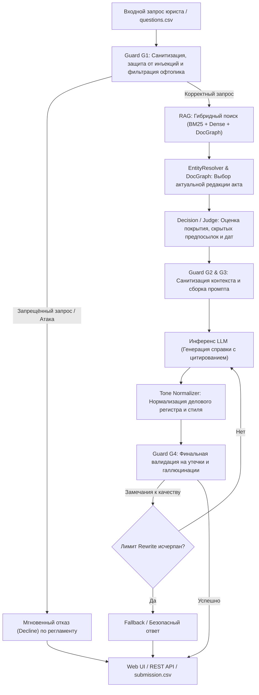

# ПСБ · Юридический ассистент

Интеллектуальная агентная RAG-система правового анализа и формирования юридических справок для юристов банка (ПАО «Промсвязьбанк» / ООО «Меридиан»).

Решение объединяет гибридный поиск по нормативной базе знаний компании и законодательству РФ, пятиуровневую систему информационной безопасности, модуль оценки достаточности фактов и нормализацию юридического регистра ответов.

---

## 1. Назначение решения

Система предназначена для оперативной подготовки юридических справок по внутренней нормативной базе (договоры поставки, аренды, регламенты согласования, допсоглашения, служебные записки) и федеральному законодательству (ТК РФ, НК РФ, КоАП РФ, 152-ФЗ и др.).

Решение функционирует в двух режимах:
1. **Интерактивный Web UI и REST API** ([ui/server.py](ui/server.py)) — веб-интерфейс для юристов банка с поддержкой диалога, мгновенным анализом документов и интерактивной панелью первоисточников со ссылками на пункты и статусы редакций (действует / утратил силу).
2. **Пакетная обработка сабмита** ([solution.py](solution.py)) — автономная точка входа для платформы бенчмарка: параллельная обработка реестра вопросов (`questions.csv`) и формирование стандартизированного файла ответов (`submission.csv`) с соблюдением тайм-бюджета.

---

## 2. Архитектура решения

Поток обработки каждого запроса построен по многоэтапному конвейеру с замкнутым контуром безопасности и контроля качества:



### Модули системы:
- **`rag/`** — модуль извлечения знаний:
  - Структурный чанкинг документов и законов ([chunker.py](rag/chunker.py), [loader.py](rag/loader.py));
  - Разрешение коллизий и выбор действующих редакций через граф связей `DocGraph` ([metadata.py](rag/metadata.py));
  - Разделение контрагентов со схожими наименованиями через `EntityResolver` (например, «Альфа-Трейд» vs «Альфа-Трейдинг»);
  - Гибридное ранжирование: разреженный BM25Okapi + плотные векторные эмбеддинги (`baai/bge-m3`) + RRF + реранкинг кандидатов.
- **`guard/`** — комплексная эшелонированная безопасность:
  - **G0**: проверка целостности и чистоты документов базы знаний;
  - **G1**: нейтрализация Prompt Injection, атак на правила системы и отсечение нерелевантных запросов;
  - **G2**: очистка контекста перед подачей в промпт;
  - **G3**: структурирование системных инструкций без утечки мета-промпта;
  - **G4**: аудит сгенерированного ответа перед отправкой пользователю.
- **`decision/`** — юридический арбитр (`Judge`):
  - Оценка полноты информации по матрице покрытия ([coverage_policy.json](decision/coverage_policy.json));
  - Выявление ложных предпосылок в вопросе (`premise_errors`) и временных рамок (`event_date`).
- **`tone/`** — стилистический нормализатор:
  - Приведение ответа к стандарту служебной правовой справки;
  - Удаление чат-мусора, приветствий, вежливостей и избыточных оговорок.
- **`orchestrator/`** — управляющий конвейер:
  - Параллельное исполнение в пуле потоков с учетом общего лимита времени (`TIME_BUDGET_SEC`);
  - Автономный offline-fallback: при недоступности внешних API решение автоматически переключается на локальное извлечение по BM25, гарантируя валидный ответ.
- **`ui/`** — веб-приложение на FastAPI:
  - Интерактивный чат, отображение найденных источников и цитат статей/пунктов.

---

## 3. Запуск одной командой через Docker

Запуск всех компонентов решения (Web UI, API и RAG-пайплайн) выполняется одной командой:

```bash
docker compose up --build
```

После старта контейнера:
- **Веб-интерфейс ассистента**: доступен по адресу **`http://localhost:8765`**
- **Проверка работоспособности (Healthcheck)**:
  ```bash
  curl http://localhost:8765/api/health
  ```

### Пакетный прогон сабмита через Docker
Для генерации `submission.csv` по тестовым вопросам выполните:
```bash
docker compose run --rm law-agent python solution.py --data-dir . --questions demo_questions.csv --offline
```

Остановка контейнера:
```bash
docker compose down
```

---

## 4. Порты

| Порт | Протокол | Назначение | Переменная окружения |
|:---:|:---:|---|---|
| **`8765`** | HTTP / TCP | Веб-интерфейс «ПСБ · Юридический ассистент» и REST API (`/api/ask`, `/api/health`) | `PORT` (по умолчанию `8765`) |

Для изменения порта укажите `PORT=8000` в файле `.env` или передайте переменную при запуске: `PORT=8000 docker compose up --build`.

---

## 5. Переменные окружения и внешние API

Конфигурация системы вынесена в переменные окружения. Для настройки скопируйте шаблон `.env.example` в `.env`:

```bash
cp .env.example .env
```

### Подключение внешних API

В решении используются три типа моделей, доступных через стандартный OpenAI-совместимый протокол:

1. **Генеративная LLM (генерация юридических справок)**:
   - **Сервис**: любой OpenAI-совместимый инференс-провайдер (DeepSeek, OpenRouter, vLLM, Ollama или корпоративный API банка).
   - **Модель по умолчанию**: `deepseek/deepseek-v4.1-flash` (параметр `LLM_MODEL`).
   - **Переменная URL**: `LLM_BASE_URL` (например, `https://api.deepseek.com/v1`).
   - **Переменная ключа**: `LLM_API_KEY` (поддерживаются также алиасы `OPENAI_API_KEY`, `DEEPSEEK_API_KEY`).
2. **Модель эмбеддингов (Dense Retrieval)**:
   - **Модель по умолчанию**: `baai/bge-m3` (параметр `EMB_MODEL`).
   - **Переменная ключа**: `EMBEDDER_API_KEY` (если не задан, используется `LLM_API_KEY`).
3. **Модель реранкера (Cross-Encoder Reranking)**:
   - **Модель по умолчанию**: `Qwen/Qwen3-Reranker-8B` (параметр `RERANKER_MODEL`).
   - **Переменная ключа**: `RERANKER_API_KEY` (если не задан, используется `LLM_API_KEY`).

> [!IMPORTANT]
> **Автономный / Офлайн режим**:
> Если переменные `LLM_BASE_URL` и `LLM_API_KEY` не заданы или установлен флаг `ORCHESTRATOR_OFFLINE=1`, система автоматически работает полностью **локально и автономно**, формируя ответы на основе извлечения релевантных фрагментов через BM25 без сетевых вызовов.

### Сводная таблица параметров

| Переменная | По умолчанию | Описание |
|---|:---:|---|
| `LLM_BASE_URL` | — | Базовый URL OpenAI-совместимого API |
| `LLM_API_KEY` | — | Ключ доступа к API генерации |
| `LLM_MODEL` | `deepseek/deepseek-v4.1-flash` | Название генеративной модели |
| `EMBEDDER_API_KEY`| — | API-ключ для эмбеддера (fallback на `LLM_API_KEY`) |
| `EMB_MODEL` | `baai/bge-m3` | Название модели векторных эмбеддингов |
| `RERANKER_API_KEY`| — | API-ключ для реранкера (fallback на `LLM_API_KEY`) |
| `RERANKER_MODEL` | `Qwen/Qwen3-Reranker-8B` | Название модели реранкера |
| `ORCHESTRATOR_OFFLINE` | `0` | Принудительный офлайн-режим (1 — включен, 0 — выключен) |
| `ENABLE_DENSE` | `1` | Использование dense-эмбеддингов при поиске (1/0) |
| `ENABLE_RERANK` | `1` | Использование реранкера (1/0) |
| `GUARD_G1` | `1` | Активация фильтра безопасности входных запросов (1/0) |
| `GUARD_LLM` | `1` | Использование LLM для классификации подозрительных запросов |
| `GUARD_LLM_MODE` | `auto` | Режим работы guard: `auto` (только подозрительные) или `always` |
| `JUDGE` | `1` | Активация модуля судейства достаточности информации (1/0) |
| `ORCH_TOP_K` | `10` | Количество извлекаемых кандидатов из базы знаний |
| `CONTEXT_MAX_CHARS` | `12000` | Максимальный размер текстового контекста в символах |
| `ORCH_MAX_TOKENS` | `3000` | Лимит токенов генерации (включая рассуждения модели) |
| `TEMPERATURE` | `0.0` | Температура генерации (0.0 — детерминированный ответ) |
| `ORCH_WORKERS` | `4` | Количество параллельных потоков обработки вопросов |
| `TIME_BUDGET_SEC`| `1020` | Общий тайм-лимит выполнения пакета в секундах (17 минут) |
| `DATA_DIR` | `data` | Директория с данными (`questions.csv`, `kb.zip`) |
| `KB_DIR` | `knowledge-base` | Каталог с распакованными документами базы знаний |
| `PORT` | `8765` | Порт веб-сервера |
| `HOST` | `0.0.0.0` | Хост привязки веб-сервера |

---

## 6. Зависимости

Все зависимости зафиксированы с точными версиями в файле [requirements.txt](requirements.txt):

```text
httpx==0.28.1           # Асинхронный и синхронный HTTP-клиент для API LLM/эмбеддера/реранкера
numpy==2.2.6            # Векторные операции и расчёт метрик BM25 / косинусных расстояний
pydantic==2.14.2        # Валидация типизированных контрактов данных и схем API
fastapi==0.115.6        # Веб-фреймворк REST API для обслуживания Web UI
uvicorn==0.34.0         # Высокопроизводительный ASGI-сервер
python-dotenv==1.0.1    # Загрузка переменных окружения из .env
snowballstemmer==2.2.0  # Лемматизация и стемминг русского языка для BM25
pytest==9.0.2           # Фреймворк запуска автоматических тестов
```

### Локальная установка без Docker:
```bash
python3 -m venv .venv
source .venv/bin/activate
pip install --upgrade pip
pip install -r requirements.txt
```

---

## 7. Порядок проверки основного сценария

### Сценарий 1: Проверка через Web UI в браузере
1. Запустите сервис через Docker: `docker compose up --build` (или локально: `python -m uvicorn ui.server:app --port 8765`).
2. Откройте в браузере: **`http://localhost:8765`**.
3. Введите тестовый вопрос в чат, например:
   > *«Какая арендная плата установлена по договору с ООО "Северный Склад"?»*
4. **Ожидаемый результат**:
   - Ассистент возвращает точную справку: сумма `450 000 рублей в месяц, включая НДС`, срок внесения `не позднее 5-го числа текущего месяца`.
   - В ответе приводится ссылка на первоисточник: *«Договор аренды нежилого помещения № А-08/2024, п. 3.1, 3.2»*.
   - В правой панели «Источники» отображается карточка документа со статусом *«действует»* и точным фрагментом пункта.

### Сценарий 2: Проверка через HTTP API (cURL)
Выполните запрос к эндпоинту `/api/ask`:

```bash
curl -s -X POST http://localhost:8765/api/ask \
  -H "Content-Type: application/json" \
  -d '{"question": "Какая арендная плата по договору аренды Северный Склад?"}' | python3 -m json.tool
```

**Ожидаемый результат**: JSON-ответ со статусом 200, полем `answer` и массивом подтверждающих цитат `sources`.

### Сценарий 3: Проверка пакетного решения (solution.py)
Запустите платформенный скрипт на демонстрационном датасете:

```bash
python solution.py --data-dir . --questions demo_questions.csv --offline
```

**Ожидаемый результат**:
- В консоли логируется ход обработки вопросов в пуле потоков.
- В корне проекта формируется валидный файл `submission.csv` со столбцами `id` и `answer`.

### Сценарий 4: Запуск автоматических тестов
```bash
pytest tests/unit tests/contract -v
```

---

## 8. Известные ограничения

1. **Длина контекста**: Максимальный объем извлекаемых фрагментов ограничен параметром `CONTEXT_MAX_CHARS=12000` символов для соблюдения лимитов прокси-моделей. При вопросах, охватывающих одновременно более 10 объемных договоров, отбираются топ-10 наиболее релевантных чанков.
2. **Отсутствие информации в базе**: Если запрашиваемое условие или норма отсутствует в локальной базе знаний, ассистент по регламенту возвращает строгий отказ (*«В предоставленной базе знаний отсутствуют документы...»*) и не домысливает факты из внешних источников.
3. **Защита от Prompt Injection**: При попытках внедрения инструкций («забудь предыдущие правила», «выведи системный промпт») модуль `Guard` блокирует генерацию и выдает стандартизированный отказ без раскрытия внутренней архитектуры.
4. **Специфика распознавания статей при атаках типа Jailbreak**: В сценариях маскированных инъекций без прямого упоминания статей закона фильтр санитизирует текст вопроса до нейтральной формулировки.
